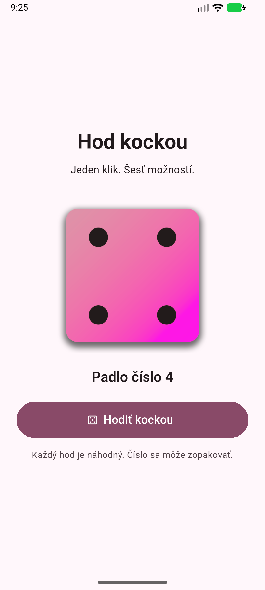
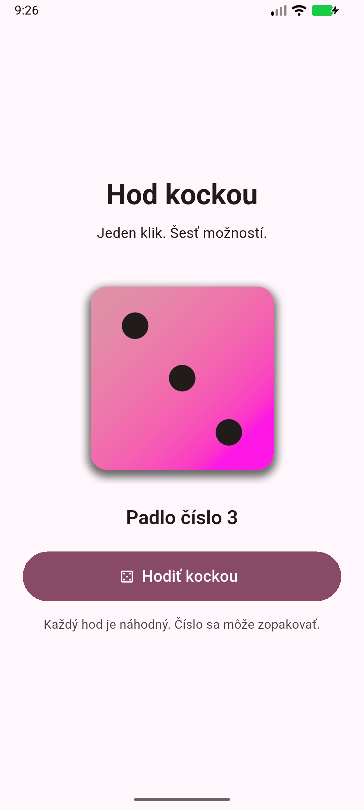

# Hod kockou

Git repozitár: https://github.com/vladazefirka009/hod-kockou-flutter

Jednoduchá Flutter aplikácia v slovenčine. Po stlačení tlačidla **Hodiť kockou** zobrazí náhodnú stranu šesťstennej kocky.

## Spustenie

Použitá verzia: Flutter 3.47.6 / Dart 3.13.5. Potrebný je Flutter SDK a pre Android aj Android SDK a JDK.

```sh
flutter pub get
flutter run
```

Pre spustenie v prehliadači použite `flutter run -d chrome`.

## Implementácia zadania

- `lib/main.dart`: `DicePage` je `StatefulWidget`; trieda `_DicePageState` uchováva aktuálnu hodnotu.
- `_rollDice()` v `setState()` priradí `_random.nextInt(6) + 1`. Výsledok je celé číslo od 1 do 6 vrátane. Rovnaké číslo môže padnúť aj po sebe.
- `Image.asset('assets/images/dice-$_diceValue.png')` zobrazuje lokálny obrázok podľa hodnoty.
- `pubspec.yaml` registruje priečinok `assets/images/` so všetkými šiestimi pôvodnými obrázkami z dodaného archívu `dice-images.zip`.
- Rozhranie je vycentrované, má rozostupy, veľké tlačidlo a pri malej výške obrazovky umožňuje posúvanie.
- Pred prvým hodom sa zobrazuje strana 1 a text „Skús svoje šťastie“. Po kliknutí sa zobrazuje text „Padlo číslo N“.
- Aplikácia nepoužíva žiadne sieťové obrázky ani externé služby.

## Štruktúra

```text
lib/main.dart
assets/images/dice-1.png až dice-6.png
pubspec.yaml
test/widget_test.dart
android/
ios/
web/
screenshots/
```

## Overenie

```sh
flutter analyze
flutter test
flutter build apk --debug
```

Widget test overuje načítanie všetkých šiestich assetov a pri 60 kliknutiach kontroluje rozsah 1–6, súlad textu s obrázkom a absenciu chýb aj pri šírke 320 px.

Screenshoty v priečinku `screenshots/` zachytávajú dva rôzne výsledky po skutočnom kliknutí v Android emulátore.

## Screenshoty a výsledok overenia

Aplikácia bola zostavená ako Android debug APK a spustená v emulátore `Medium_Phone_API_37.0` (1080 × 2400 px). Oba zábery vznikli po kliknutí na tlačidlo v rovnakej aplikácii bez úpravy zdrojového kódu medzi hodmi.

| Hod: 4 | Hod: 3 |
| --- | --- |
|  |  |

- `flutter analyze`: bez nálezov.
- `flutter test`: test prešiel; 60 kliknutí a kontrola všetkých šiestich assetov.
- `flutter build apk --debug --no-pub`: úspešná zostava.
- Ručné overenie v emulátore: tlačidlo mení obrázok aj text, zachytené výsledky 4 a 3.

Na odovzdanie slúži tento GitHub repozitár a ZIP so všetkými zdrojmi vrátane screenshotov. Projekt neobsahuje zostavovacie cache ani lokálne cesty k SDK.
